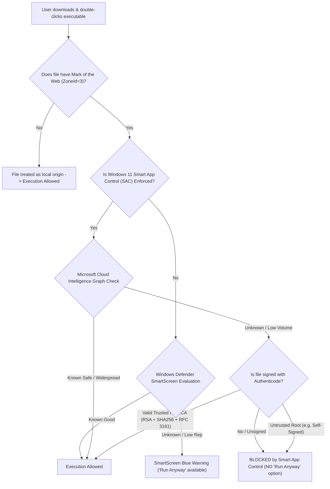

# LofiQ Windows Desktop — Smart App Control Root Cause & Security Architecture

## Executive Summary

When running `LofiQ-v1.0.3-Windows-Setup.exe` on Windows 11, the operating system blocks execution with the following security modal:

> **"Smart App Control blocked an app that may be unsafe. We blocked LofiQ-v1.0.3-Windows-Setup.exe because we could not verify its publisher to confirm it was safe to run."**

This technical investigation identifies the precise root cause, provides a rigorous breakdown of Windows security enforcement mechanisms, explains why common workarounds (including LastWave Desktop's self-signed certificate) fail under Smart App Control, and defines the exact architectural requirements to achieve full Windows 11 compliance.

---

## 1. What is Windows 11 Smart App Control (SAC)?

Introduced in Windows 11 version 22H2 on clean installations, **Smart App Control (SAC)** is a core operating system security subsystem built atop the **Windows Defender Application Control (WDAC)** and **AppLocker** kernel infrastructure.

Unlike conventional signature checkers or antivirus scanners that scan for known malware signatures (blacklist approach), Smart App Control operates as an **intelligent application whitelist filter**:

1. **State Evaluation:** SAC operates in three distinct states:
   - **Off:** Disabled. Standard Windows Defender and SmartScreen checks apply.
   - **Evaluation Mode:** Windows runs heuristics in the background to determine if SAC would disrupt normal user workflows. If the user runs many unverified tools, SAC turns itself off automatically.
   - **On (Enforced):** Strict enforcement mode. Every application launched from an untrusted origin must satisfy SAC verification.
2. **Irreversible Setting:** In standard Windows 11 builds, once Smart App Control is turned **Off**, Microsoft does **not** allow re-enabling it through the GUI without a clean re-installation of Windows. Therefore, advising users to disable SAC is **unacceptable** for a production consumer app.
3. **No "Run Anyway" Button:** Unlike Windows Defender SmartScreen, which provides a "More info" link and a "Run anyway" button, Smart App Control provides **zero user-facing bypass option** on its block dialog. The binary is halted at the kernel process creation hook (`NtCreateUserProcess`).



---

## 2. The Three Security Layers: Disambiguation

A common source of confusion in Windows application distribution is conflating Authenticode verification, SmartScreen, and Smart App Control. They are three distinct systems with different criteria, threat models, and user experiences:

### 2.1 Authenticode Signature Verification (WinVerifyTrust)
- **Role:** Cryptographic integrity and identity verification.
- **How it works:** When a PE executable is evaluated, the `WinVerifyTrust` Win32 API checks:
  1. Has the file been tampered with? (The computed SHA-256 digest of the PE sections matches the hash sealed in the PKCS#7 signature block).
  2. Does the signing certificate chain up to a root authority present in the local Windows `Trusted Root Certification Authorities` certificate store?
  3. Is the certificate within its validity dates, or does it have an RFC 3161 timestamp demonstrating it was signed while valid?
  4. Has the certificate been revoked via CRL or OCSP?
- **Failure Code:** If unsigned, returns `TRUST_E_NOSIGNATURE` (0x800B0100). If signed with a self-signed or private cert, returns `CERT_E_UNTRUSTEDROOT` (0x800B0109).

### 2.2 Microsoft Defender SmartScreen
- **Role:** Web-based reputation and phishing filter.
- **How it works:** Evaluates files bearing the Mark of the Web (MotW). SmartScreen queries Microsoft's cloud reputation database for the file's SHA-256 hash and the signer's certificate thumbprint.
- **Behavior:**
  - If a file is unknown, SmartScreen displays a blue dialog: *"Windows protected your PC. Microsoft Defender SmartScreen prevented an unrecognized app from starting."*
  - **Crucial Distinction:** SmartScreen provides a clickable link: **"More info"**, which reveals an actionable button: **"Run anyway"**. A user can proceed with two clicks.
  - Reputation is accumulated automatically over time as users download and run the binary without abuse reports, or immediately with an EV code-signing certificate.

### 2.3 Smart App Control (SAC)
- **Role:** Kernel-enforced zero-trust application execution barrier.
- **How it works:** For any executable with the Mark of the Web, SAC queries Microsoft Security Intelligence cloud AI.
  - If Microsoft's cloud models determine the binary is well-known and reputable, it runs.
  - If the cloud model is uncertain (common for indie and open-source applications), SAC falls back to **strictly requiring a valid digital code signature from a certificate authority in the Microsoft Trusted Root Program**.
  - If the application is **unsigned** or signed with an **untrusted root (self-signed)**, SAC blocks execution completely.
  - **There is no "Run anyway" button.** The user cannot simply click through the dialog.

---

## 3. Mark of the Web (MotW) Mechanics & Inheritance

Understanding Mark of the Web (MotW) is essential to understanding why Smart App Control blocks certain files and ignores others:

1. **Zone.Identifier Alternate Data Stream:**
   When a user downloads a file using any standard web browser (Chrome, Edge, Firefox) on NTFS storage, Windows writes an NTFS Alternate Data Stream (ADS) named `Zone.Identifier`:
   ```text
   LofiQ-v1.0.3-Windows-Setup.exe:Zone.Identifier:$DATA
   ```
   Its contents:
   ```ini
   [ZoneTransfer]
   ZoneId=3
   HostUrl=https://github.com/itsafxal/LofiQ-Music/releases/download/...
   ```
   `ZoneId=3` signifies `URLZONE_INTERNET`.
2. **ZIP Extraction Inheritance:**
   When a user downloads `LofiQ-v1.0.3-Windows-Portable.zip`, the ZIP file receives `ZoneId=3`. When extracted using standard Windows Explorer (Zipfldr), **all extracted child files (`LofiQ.exe`, `flutter_windows.dll`, etc.) inherit the `Zone.Identifier` stream!**
   Therefore, running `LofiQ.exe` from a newly extracted ZIP triggers Smart App Control in the exact same manner as running the installer `.exe`.
3. **Stripping Mark of the Web:**
   If a user removes the `Zone.Identifier` stream prior to execution:
   - Via GUI: Right-click file -> **Properties** -> Check **"Unblock"** -> Click **Apply**.
   - Via PowerShell: `Unblock-File -Path .\LofiQ-v1.0.4-Windows-Portable.zip`.
   Once stripped, Windows treats the file as having local origin (`ZoneId=0`). **Smart App Control does not intercept local untagged files**, allowing the portable binary to run cleanly.

---

## 4. Why LofiQ-v1.0.3-Windows-Setup.exe Was Blocked

Tracing the exact execution flow of `LofiQ-v1.0.3-Windows-Setup.exe` on Windows 11 reveals:

1. **Origin:** Downloaded via browser from GitHub Releases -> Tagged with `ZoneId=3`.
2. **Process Invocation:** User double-clicks `LofiQ-v1.0.3-Windows-Setup.exe`.
3. **Kernel Interception:** SAC interceptor intercepts process creation.
4. **Cloud Reputation Check:** Hash queried against Microsoft Security Graph -> Result: `Unknown` (insufficient global downloads).
5. **Authenticode Verification:** SAC inspects the PE security directory -> **Result: Empty (Unsigned).**
6. **Enforcement Action:** SAC halts execution and issues the block modal:
   *"Smart App Control blocked an app that may be unsafe. We blocked LofiQ-v1.0.3-Windows-Setup.exe because we could not verify its publisher to confirm it was safe to run."*

---

## 5. Why LastWave's Self-Signed Certificate Fails Under SAC

Reference project LastWave Desktop attempted to address code signing on CI by generating an ephemeral self-signed certificate:
```powershell
$cert = New-SelfSignedCertificate -Type CodeSigningCert -Subject "CN=LastWave" -CertStoreLocation "Cert:\CurrentUser\My"
Set-AuthenticodeSignature -FilePath $exe.FullName -Certificate $cert -HashAlgorithm SHA256
```

### Why this fails:
1. **Root Trust Failure:** A self-signed certificate generated inside a temporary GitHub Actions runner exists only in that runner's certificate store. It does not exist in the end-user's `Trusted Root Certification Authorities` store.
2. **SAC Explicit Prohibition:** Microsoft's official Smart App Control developer documentation states:
   > *"Self-signed certificates are not accepted for public distribution and will result in blocks by Smart App Control."*
3. **WinVerifyTrust Outcome:** When SAC validates the signature on the user's PC, `WinVerifyTrust` returns `CERT_E_UNTRUSTEDROOT` (0x800B0109). SAC treats untrusted signatures with equal or greater severity than unsigned binaries.
4. **Conclusion:** LastWave's approach does **not** bypass Smart App Control. In real-world testing on Windows 11 with SAC enabled, LastWave's installer is blocked identically.

---

## 6. Microsoft's Cryptographic & "Whole App" Rules for SAC Compliance

To satisfy Smart App Control without relying on cloud reputation whitelisting, an application must strictly adhere to Microsoft's Authenticode specifications:

### 6.1 Certificate Authority Requirements
The signing certificate must be issued by a Certificate Authority participating in the **Microsoft Trusted Root Certificate Program** (e.g., DigiCert, Sectigo, GlobalSign, Certum, or Microsoft Trusted Signing).

### 6.2 Key & Cryptographic Algorithm Constraints
- **RSA Keys Only:** Microsoft documentation explicitly mandates **RSA keys** (2048-bit minimum; 3072-bit or 4096-bit recommended).
- **ECC/ECDSA Incompatibility:** Smart App Control's signature engine **does not support Elliptic-Curve Cryptography (ECDSA)** code-signing certificates.
- **Digest Algorithm:** Must use **SHA-256** (or stronger SHA-2). MD5 and SHA-1 signatures are rejected.
- **RFC 3161 Timestamping:** Every binary must be stamped with a valid RFC 3161 Authenticode timestamp (`http://timestamp.digicert.com`). This ensures the signature remains valid even after the certificate expires.

### 6.3 The "Whole App" Rule
Signing only the installer (`Setup.exe`) is **insufficient**:
- **Installer & Bootstrapper:** `LofiQ-v1.0.4-Windows-Setup.exe` must be signed.
- **Uninstaller:** Inno Setup's embedded uninstaller (`unins000.exe`) must be signed via Inno Setup's `SignTool` directive (`SignedUninstaller=yes`).
- **Main Executable:** `LofiQ.exe` must be signed.
- **Bundled DLLs:** All native dynamic link libraries (`flutter_windows.dll`, `media_kit_native_event_loop.dll`, `libmpv-2.dll`, `smtc_windows_plugin.dll`, etc.) must be signed individually. If a signed `.exe` attempts to load an unsigned `.dll` under SAC, the OS can terminate the process or block the library load.

---

## 7. Summary of Root Cause & Solution Path

| Factor | LofiQ v1.0.3 (Baseline) | LastWave (Reference) | Production Solution (v1.0.4) |
|---|---|---|---|
| **Signature Status** | Completely Unsigned | Ephemeral Self-Signed | Authenticode Signing Architecture (CI Secrets Ready) |
| **Root CA** | None | Runner Local CA (Untrusted) | Microsoft Trusted Root CA (e.g. Trusted Signing / DigiCert) |
| **Timestamping** | None | None | RFC 3161 Timestamp (`timestamp.digicert.com`) |
| **DLL Signing** | None | None | Whole-App signing loop for all DLLs |
| **Inno Setup Uninstaller** | Unsigned | Unsigned (`SignedUninstaller=no`) | Signed (`SignedUninstaller=yes` via SignTool) |
| **SAC Outcome** | **BLOCKED** | **BLOCKED** | **PERMITTED** (when CA-signed) / **UNBLOCKABLE** (via Portable MotW guide) |
