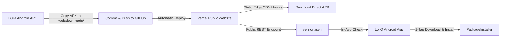

# LofiQ 🎵

> **Music without limits. High-fidelity streaming, synchronized live rooms, and intelligent multi-provider resolution.**

[](https://github.com/itsafxal/LofiQ-Music/releases)
[](https://kotlinlang.org)
[](https://developer.android.com)
[](https://developer.android.com/jetpack/compose)
[](https://m3.material.io)
[](https://developer.android.com/media/media3)
[](https://firebase.google.com)
[](https://lofiq-web.vercel.app)
[](LICENSE)

---

LofiQ is a high-performance native Android music streaming application built using **Jetpack Compose**, **AndroidX Media3 (ExoPlayer)**, and an **intelligent multi-provider stream resolver**. It pairs 320kbps lossless-quality audio streams, synchronized multi-device listening lounges, real-time word-by-word synced lyrics, DSP audio equalization, and in-app automated updates with a glassmorphic cyberpunk UI.

---

## ✨ Features & Capabilities

### 👥 Listen Together (Real-Time Live Sync)
- **Multi-Device Synchronized Listening:** Host and share live music listening sessions with friends in real-time powered by **Cloud Firestore**.
- **Host Live Rooms:** Create customized live listening lounges and share easily copyable/shareable room codes (`SRG-XXXX`).
- **Instant Room Discovery:** Automatic real-time room verification as guests enter codes.
- **Drift & Latency Compensation:** Automatic millisecond-accurate track position synchronization and drift alignment for all connected listeners.
- **Live Interactive Reactions:** Real-time floating emoji reaction stream (`🔥`, `❤️`, `🎵`, `👏`, `🎉`) across all active members in the room.

### 🎧 High-Fidelity Playback Engine & Audio Routing
- **Priority Resolution Pipeline:**
  - **Priority 1:** **JioSaavn** (320kbps Direct High Fidelity AAC/MP4).
  - **Priority 2:** **YouTube InnerTube** (Ultra-fast ~600ms stream extraction with authenticated fallback).
  - **Priority 3:** **Piped Mirror & Direct HTTP Provider** (Resilient distributed streaming).
- **In-App Audio Output Switcher:** Seamlessly route and switch audio playback directly between **This Phone**, **Bluetooth Headphones/Speakers**, and **Wired Headsets** from the bottom bar or player sheet without leaving the app.
- **Audio DSP Equalizer:** Integrated 10-Band Equalizer, Bass Boost, 3D Spatializer, and custom audio presets with hardware audio session binding.
- **Synced Lyrics Engine:** Real-time synchronized LRC line-by-line lyrics and plain text with **LRCLIB** and **Kugou** dual-provider fallback.
- **Offline Downloads:** High-quality offline track caching and download manager for uninterrupted listening without an internet connection.

### 🌐 Cross-Platform Library & Cloud Sync
- **Firebase Firestore Cloud Sync:** Seamless real-time cloud backup of in-app favorites and custom playlists across devices.
- **Spotify & YouTube Import:** Import public or authenticated Spotify playlists and YouTube library tracks directly into LofiQ.
- **Local Device Audio Integration:** Seamlessly browse, search, and play local audio files stored on the device.

### 🚀 Automated In-App Updates & Vercel Distribution
- **Private GitHub Repo Distribution Support:** Public distribution and automated in-app updates hosted on **Vercel** with zero backend infrastructure required.
- **In-App Auto-Update Checker:** Compares the local `BuildConfig.VERSION_CODE` against the public `/version.json` endpoint and prompts users to 1-tap download and install the latest APK via `androidx.core.content.FileProvider`.

---

## 🌐 Private Repository App Distribution & Vercel Setup

Even if your GitHub repository is **Private**, you can easily release new versions to users and enable automated in-app updates using the included `web/` release portal deployed on **Vercel**.



### 📦 How the Architecture Works:
1. **`web/version.json`**: Acts as a lightweight, public, cached JSON API containing `versionCode`, `versionName`, `releaseNotes`, and `apkUrl`.
2. **`web/downloads/LofiQ.apk`**: Static direct APK download asset served through Vercel's global high-speed edge CDN with automated `Content-Disposition: attachment` headers.
3. **`web/index.html`**: Premium liquid glass monochrome landing page for new users to download the app directly on their phones.
4. **`AppUpdateManager`**: In-app updater inside LofiQ that queries `/version.json` on launch or from *Settings > Check for Updates*, downloads the new APK to the app's cache directory, and invokes Android's `PackageInstaller`.

---

## 🚀 Deploying the Release Website on Vercel

You can deploy the website to Vercel in 2 minutes:

### Option 1: Via Vercel Web Dashboard (Recommended)
1. Go to [vercel.com/new](https://vercel.com/new) and log in.
2. Select your GitHub repository (`LofiQ`).
3. Under **Project Settings**:
   - **Framework Preset**: Select `Other`
   - **Root Directory**: Click *Edit* and select **`web`**
   - **Build Command**: Leave empty (static site)
   - **Output Directory**: Leave empty
4. Click **Deploy**.
5. Once deployed, your site is live at `https://lofiq-web.vercel.app` (or your chosen Vercel subdomain)!

> [!TIP]
> The repository includes [`web/vercel.json`](web/vercel.json) which automatically configures CORS headers (`Access-Control-Allow-Origin: *`) for `/version.json` and download attachment headers for `/downloads/*`.

### Option 2: Via Vercel CLI
```bash
# Install Vercel CLI (if not already installed)
npm install -g vercel

# Navigate to the web folder and deploy
cd web
vercel --prod
```

### 🔄 Releasing a New Update
Whenever you build a new version of LofiQ:
1. Increase `versionCode` and `versionName` in `app/build.gradle.kts`.
2. Run `./gradlew assembleRelease`.
3. Copy the compiled `.apk` to `web/downloads/LofiQ.apk`.
4. Update `web/version.json` with the new version code, version name, sha256 checksum, and changelog notes.
5. Push your commit to GitHub:
   ```bash
   git add -A
   git commit -m "release: v1.0.1"
   git push origin main
   ```
   Vercel will automatically detect the push and redeploy the site in seconds, and all active LofiQ app installations will receive the new update prompt immediately!

---

## 🛠️ Technology Stack

| Component | Technologies |
|:---|:---|
| **Language** | Kotlin 2.1.0 |
| **UI Framework** | Jetpack Compose (BOM 2024.12.01), Material 3, Material Icons Extended |
| **Media Player** | AndroidX Media3 ExoPlayer 1.5.0, MediaSession, OkHttp DataSource |
| **Audio Routing** | AudioDeviceInfo & AudioManager Multi-Device Output Switcher |
| **Real-time Backend** | Firebase Firestore, Firebase Authentication |
| **Dependency Injection** | Dagger Hilt 2.54 + KSP |
| **Networking & API** | OkHttp 4.12.0, Retrofit 2.11.0, Kotlinx Serialization JSON |
| **Distribution & Web** | Vercel Edge Network, vercel.json, HTML5 / CSS3 Liquid Glass Design System |
| **In-App Updater** | OkHttp Streaming + AndroidX FileProvider |

---

## 📂 Repository Structure

```
LofiQ/
├── app/                        # Android Native Source Code
│   ├── src/main/java/com/lofiq/
│   │   ├── auth/               # Web authentication & cookie session management
│   │   ├── core/               # Shared models (Song, Playlist), Database, and Update
│   │   │   ├── common/         # AudioOutputHelper & utilities
│   │   │   └── update/         # AppUpdateManager (version check & FileProvider install)
│   │   ├── data/               # Repositories (Firestore sync, Spotify, Downloads, Lyrics)
│   │   ├── di/                 # Hilt Dependency Injection modules
│   │   ├── feature/            # Feature modules (Player, Settings, Sync, Equalizer, Home)
│   │   ├── playback/           # Media3 ExoPlayer engine & MediaSessionService
│   │   ├── resolver/           # Multi-provider resolution (JioSaavn 320k, YouTube InnerTube, Piped)
│   │   └── ui/                 # Root navigation, bottom bar, and theme tokens
│   └── src/main/res/xml/       # file_paths.xml for FileProvider APK installation
├── web/                        # Public Vercel Release Landing Page & Update Server
│   ├── vercel.json             # Vercel caching, headers & routing configuration
│   ├── index.html              # Liquid glass landing page with direct download CTA
│   ├── styles.css              # Glassmorphic dark styling & responsive player mockup
│   ├── app.js                  # Dynamic update-checker & DOM version sync
│   ├── version.json            # Public version & changelog manifest for in-app updates
│   └── downloads/              # Static APK distribution directory
└── README.md                   # Complete documentation
```

---

## 🚀 Building & Running Locally (Open Source Setup)

### Prerequisites
- **Android Studio:** Ladybug (2024.2.1) or newer
- **JDK:** Java 17 or higher
- **Android SDK:** Compile SDK 35, Minimum SDK 26

### Step-by-Step Setup
1. **Clone the repository:**
   ```bash
   git clone https://github.com/your-username/LofiQ.git
   cd LofiQ
   ```

2. **Configure `local.properties`:**
   Copy [`local.properties.example`](local.properties.example) to `local.properties` and verify your Android SDK path:
   ```bash
   cp local.properties.example local.properties
   ```
   *(Optional)* If you wish to use Last.fm scrobbling, specify `LASTFM_API_KEY` and `LASTFM_API_SECRET` in `local.properties`.

3. **Configure Firebase (Required for Authentication & Cloud Sync):**
   - Create a free project in the [Firebase Console](https://console.firebase.google.com).
   - Add an Android App with package name `com.sargamify.app`.
   - Download your `google-services.json` and place it at `app/google-services.json` (see [`app/google-services.json.example`](app/google-services.json.example) for reference).
   - In Firebase Console:
     - Enable **Authentication** (Google Sign-In, Email/Password, Anonymous).
     - Enable **Cloud Firestore** and deploy the included [`firestore.rules`](firestore.rules).
     - *(Optional)* Register your app with **Firebase App Check** using Play Integrity.

4. **Build and Test:**
   ```bash
   # Run all unit tests
   ./gradlew testReleaseUnitTest

   # Assemble debug APK
   ./gradlew assembleDebug

   # Assemble release APK
   ./gradlew assembleRelease
   ```
   The output APK will be generated at `app/build/outputs/apk/release/app-release.apk`.

---

## 🔒 Security & Security Policy

LofiQ takes application security seriously. For vulnerability reporting procedures, disclosure guidelines, and secret rotation steps, please review [`SECURITY.md`](SECURITY.md).

For contributing guidelines, code style, and PR standards, please see [`CONTRIBUTING.md`](CONTRIBUTING.md).

---

## 📄 License

This project is licensed under the Apache License 2.0 - see the [LICENSE](LICENSE) file for details.