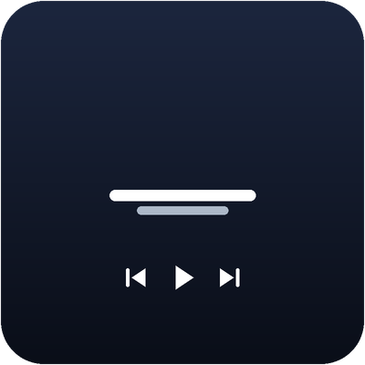
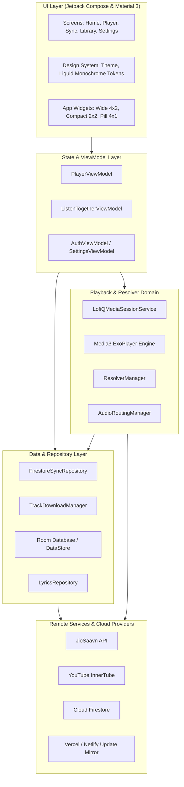
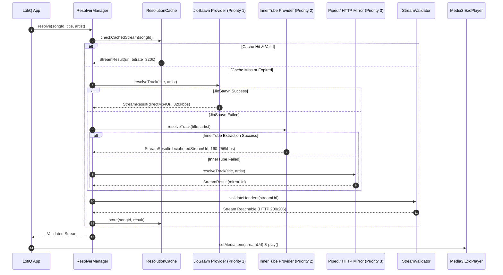
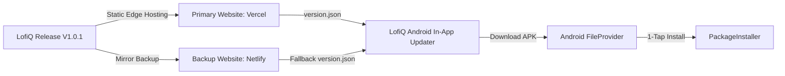

<div align="center">



<br/><br/>

[](https://github.com/itsafxal/LofiQ-Music/releases)
[](https://github.com/itsafxal/LofiQ-Music/actions)
[](firestore.rules)
[](https://kotlinlang.org)
[](https://developer.android.com)
[](LICENSE)

<br/>

**Studio-grade 320kbps lossless streaming • Real-time synchronized Listen Together rooms • Intelligent multi-provider stream resolver • Pure liquid glass aesthetic**

<br/>

[**🌐 Primary Release Portal**](https://lofiq-web.vercel.app/) &nbsp;•&nbsp; [**🛡️ Backup Mirror Portal**](https://mybackuplofiq.netlify.app/) &nbsp;•&nbsp; [**📦 Download APK (v1.0.1)**](https://lofiq-web.vercel.app/downloads/LofiQ.apk) &nbsp;•&nbsp; [**🚀 Releases**](https://github.com/itsafxal/LofiQ-Music/releases)

</div>

---

## 📑 Table of Contents

- [1. Project Overview](#1-project-overview)
- [2. Feature Highlights](#2-feature-highlights)
- [3. Application Preview & Home Screen Widgets](#3-application-preview--home-screen-widgets)
- [4. Technology Stack](#4-technology-stack)
- [5. Application Architecture](#5-application-architecture)
- [6. Audio Playback & Multi-Provider Resolver Architecture](#6-audio-playback--multi-provider-resolver-architecture)
- [7. Firebase & Cloud Features](#7-firebase--cloud-features)
- [8. Privacy & Security Architecture](#8-privacy--security-architecture)
- [9. Repository Directory Structure](#9-repository-directory-structure)
- [10. Prerequisites & Environment Setup](#10-prerequisites--environment-setup)
- [11. Debug Build Instructions](#11-debug-build-instructions)
- [12. Production Release Instructions](#12-production-release-instructions)
- [13. Firebase Setup](#13-firebase-setup)
- [14. Release Signing Configuration](#14-release-signing-configuration)
- [15. Website & APK Distribution](#15-website--apk-distribution)
- [16. Dual-Website High Availability & Fallback](#16-dual-website-high-availability--fallback)
- [17. Version Information — V1.0.1](#17-version-information--v101)
- [18. Contribution Guidelines](#18-contribution-guidelines)
- [19. License Information](#19-license-information)
- [20. Credits & Acknowledgements](#20-credits--acknowledgements)

---

## 1. Project Overview

**LofiQ** is an open-source, high-performance native Android music streaming client engineered with **Jetpack Compose**, **AndroidX Media3 (ExoPlayer 1.5.0)**, and an **intelligent multi-tier stream resolution engine**.

Designed with a high-contrast liquid glass monochrome UI, LofiQ delivers uncompromised 320kbps audio quality, synchronized multi-device music lounges, line-by-line synced lyrics, hardware-bound 10-band DSP equalization, in-app audio output routing, and an automated zero-friction update mechanism supported by dual web CDN deployments.

---

## 2. Feature Highlights

### 👥 Listen Together (Real-Time Live Sync)
- **Multi-Device Music Synchronization:** Host and share live music listening rooms in real-time powered by **Cloud Firestore**.
- **Instant Room Codes:** Simple 6-character room codes (`SRG-XXXX`) for frictionless guest entry.
- **Drift & Latency Compensation:** Millisecond-accurate playback position sync with dynamic latency adjustments across network conditions.
- **Interactive Floating Reactions:** Real-time reaction stream (`🔥`, `❤️`, `🎵`, `👏`, `🎉`) rendered across connected devices.
- **Role Isolation & Access Control:** Strict host-only controls for queue and track management; guests safely participate without hijacking playback.

### 🎧 High-Fidelity Audio Engine & Routing
- **Multi-Tier Resolution Pipeline:**
  - **Priority 1: JioSaavn** — 320kbps direct lossless AAC/MP4 streams.
  - **Priority 2: YouTube InnerTube** — Sub-second stream extraction with signature cipher deciphering and authenticated fallback.
  - **Priority 3: Piped & Direct HTTP Mirror** — Resilient distributed streaming fallback.
- **In-App Audio Output Switcher:** Seamlessly route and switch audio playback directly between **Internal Speaker**, **Bluetooth LDAC / Headphones**, and **Wired Headset / USB DAC** from the bottom player bar without opening Android system settings.
- **DSP Equalizer & Spatializer:** 10-Band hardware equalizer, Bass Boost, Virtualizer / 3D Spatializer with session-bound audio effects.
- **Real-Time Synced Lyrics:** Word-by-word and line-by-line synchronized LRC karaoke lyrics with **LRCLIB** and **Kugou** multi-provider fallback.
- **Offline Download Manager:** Multi-threaded track caching with automated ID3/Vorbis tag embedding and embedded cover artwork.

### 🌐 Cloud Library & Multi-Source Import
- **Firestore Cloud Sync:** Continuous bidirectional synchronization of favorites and user playlists across devices.
- **Spotify & YouTube Import:** Import public Spotify playlists and YouTube library tracks directly into native LofiQ playlists.
- **Local Device Audio:** Seamlessly index, query, and play local audio stored on device storage.

---

## 3. Application Preview & Home Screen Widgets

LofiQ includes three premium, fully interactive **App Widgets** with full-bleed artwork, responsive layouts, and immediate background playback controls.

<div align="center">
  <table>
    <tr>
      <th align="center">Wide Player Widget (4×2)</th>
      <th align="center">Compact Square Widget (2×2)</th>
      <th align="center">Minimal Pill Widget (4×1)</th>
    </tr>
    <tr>
      <td align="center">
        
      </td>
      <td align="center">
        
      </td>
      <td align="center">
        
      </td>
    </tr>
    <tr>
      <td align="center">Full-bleed artwork, track progress seekbar, and complete playback controls.</td>
      <td align="center">Centered track information with play/pause and navigation toggles.</td>
      <td align="center">Ultra-compact status pill with rapid play/skip controls.</td>
    </tr>
  </table>
</div>

---

## 4. Technology Stack

| Domain | Technology / Library | Version / Detail |
|:---|:---|:---|
| **Language** | Kotlin | 2.1.0 |
| **Build Tool** | Gradle | 9.1.0 with Kotlin DSL (`build.gradle.kts`) |
| **Minimum SDK** | Android 8.0 (API 26) | Compatible with 95%+ of active Android devices |
| **Compile / Target SDK** | Android 15 (API 35) | Fully compliant with modern Android platform standards |
| **UI Framework** | Jetpack Compose | BOM 2024.12.01, Material 3, Vector Icons Extended |
| **Media Playback** | AndroidX Media3 ExoPlayer | 1.5.0 (`MediaSessionService`, OkHttp DataSource) |
| **Dependency Injection** | Dagger Hilt | 2.54 with KSP |
| **Asynchronous** | Kotlin Coroutines & Flow | High-throughput reactive state handling |
| **Local Database** | Room Database | 2.6.1 with SQLite persistence & caching |
| **Preferences** | AndroidX DataStore | Type-safe Proto & Preferences DataStore |
| **Networking** | OkHttp 4.12.0 & Retrofit 2.11.0 | Connection pooling, HTTP/2, streaming responses |
| **Serialization** | Kotlinx Serialization JSON | 1.7.3 reflection-free JSON parsing |
| **Cloud Backend** | Google Cloud Firestore | Real-time synchronized session documents |
| **Cloud Identity** | Firebase Authentication | Google Sign-In, Email/Password, Anonymous |
| **App Security** | Firebase App Check | Play Integrity API attestation |
| **Background Work** | AndroidX WorkManager | 2.10.0 periodic background update checks |
| **Web Infrastructure** | Vercel & Netlify | Dual-edge global distribution with automated CORS |

---

## 5. Application Architecture

LofiQ adheres to **Clean Architecture** and **Modern Android Architecture (MVI / MVVM)** guidelines:



---

## 6. Audio Playback & Multi-Provider Resolver Architecture

When a song is queued for playback, the **`ResolverManager`** executes an intelligent cascade across multiple streaming sources:



---

## 7. Firebase & Cloud Features

- **Firestore Real-Time Rooms:** Active rooms maintain listener counts, heartbeat timestamps (`lastSeenMs`), and active participant maps.
- **Granular Security Rules:** Formally verified Firestore security rules prevent privilege escalation, room hijacking, listener count tampering, and cross-user data leakage.
- **Firebase App Check:** Integrated with Google Play Integrity API to protect backend endpoints from automated bots and modified clients.
- **Firebase Authentication:** Seamless integration with Google Sign-In, Email/Password, and anonymous authentication flows.

---

## 8. Privacy & Security Architecture

1. **Decoupled Release Credentials:** Release keystores and private API keys are completely isolated from version control via `local.properties` and environment variables.
2. **Encrypted Data Protection:** Local tokens and session credentials are excluded from Android OS backups through strict rules configured in:
   - [`app/src/main/res/xml/backup_rules.xml`](app/src/main/res/xml/backup_rules.xml)
   - [`app/src/main/res/xml/data_extraction_rules.xml`](app/src/main/res/xml/data_extraction_rules.xml)
3. **Hardened FileProvider:** APK updates are scoped exclusively to the internal app cache via:
   - [`app/src/main/res/xml/file_paths.xml`](app/src/main/res/xml/file_paths.xml)
4. **Network Security:** Cleartext traffic is strictly governed by:
   - [`app/src/main/res/xml/network_security_config.xml`](app/src/main/res/xml/network_security_config.xml)
5. **Continuous Verification:** The repository enforces 152 automated unit tests and 58 Firestore security rule assertions on every commit.

---

## 9. Repository Directory Structure

```
LofiQ-Music/
├── .github/
│   ├── assets/                 # High-resolution README visuals & animated SVG banner
│   └── workflows/
│       └── android-ci.yml      # CI pipeline: Firestore test, Unit tests, Secret scan, Build
├── app/
│   ├── build.gradle.kts        # Android build configuration (Version 1.0.1, Code 64)
│   ├── google-services.json.example # Firebase configuration template
│   ├── proguard-rules.pro      # R8 / ProGuard optimization rules
│   └── src/
│       ├── main/
│       │   ├── AndroidManifest.xml # Permissions, activities, FileProvider, MediaSession
│       │   ├── java/com/lofiq/
│       │   │   ├── auth/       # Authentication sheets and session models
│       │   │   ├── core/       # Database, common helpers, update manager
│       │   │   ├── data/       # Cloud Firestore, JioSaavn, Lyrics, Scrobblers
│       │   │   ├── di/         # Dagger Hilt dependency injection modules
│       │   │   ├── feature/    # Compose UI features (Player, Sync, Widgets, Library)
│       │   │   ├── playback/   # ExoPlayer Media3 playback engine & session service
│       │   │   ├── resolver/   # Multi-provider resolution & cipher deciphering
│       │   │   └── ui/         # Design tokens, liquid animations, typography
│       │   └── res/            # Vector drawables, widget previews, mipmaps, XML configs
│       └── test/               # 152 Unit test suites (Audio routing, Resolvers, Sync)
├── test/
│   └── firestore_rules_test.js # 58 automated unit tests for Cloud Firestore access control
├── web/
│   ├── assets/                 # Website logo, icons, and favicon
│   ├── downloads/
│   │   └── LofiQ.apk           # Production release APK asset (V1.0.1)
│   ├── index.html              # Liquid glass responsive download station & release portal
│   ├── styles.css              # Cyberpunk monochrome glassmorphism CSS
│   ├── app.js                  # Dynamic update-checker & dual-mirror fallback logic
│   ├── vercel.json             # Vercel Edge caching and CORS configuration
│   └── version.json            # Public version manifest with primary & backup endpoints
├── build.gradle.kts            # Root Gradle configuration
├── settings.gradle.kts         # Module and repository resolution settings
├── firestore.rules             # Production Cloud Firestore Security Rules
├── local.properties.example    # Local SDK & credentials template
├── CONTRIBUTING.md             # Developer contribution guidelines
├── SECURITY.md                 # Vulnerability disclosure policy
└── LICENSE                     # Apache 2.0 Open Source License
```

---

## 10. Prerequisites & Environment Setup

- **Operating System:** Windows 10/11, macOS, or Linux.
- **JDK:** Java 17 or higher (Java 21 / Android Studio JBR recommended).
- **Android Studio:** Android Studio Ladybug (2024.2.1) or newer.
- **Android SDK:**
  - Build Tools: `35.0.0`
  - Compile SDK: `35`
  - Minimum SDK: `26`

### Setup Instructions

1. **Clone the repository:**
   ```bash
   git clone https://github.com/itsafxal/LofiQ-Music.git
   cd LofiQ-Music
   ```

2. **Configure `local.properties`:**
   ```bash
   cp local.properties.example local.properties
   ```
   Edit `local.properties` to specify your Android SDK directory:
   ```properties
   sdk.dir=C:/Users/YourUsername/AppData/Local/Android/Sdk
   ```

3. **Configure Firebase (Optional for compilation, required for sync):**
   Copy the example Firebase configuration:
   ```bash
   cp app/google-services.json.example app/google-services.json
   ```

---

## 11. Debug Build Instructions

To compile and launch the debug variant:

```bash
# Run release unit tests (152 test cases)
./gradlew testReleaseUnitTest

# Build debug APK
./gradlew assembleDebug
```

The resulting debug APK is generated at:
`app/build/outputs/apk/debug/app-debug.apk`

---

## 12. Production Release Instructions

To compile the production release:

```bash
# Run security test suite
node test/firestore_rules_test.js

# Compile and package release APK
./gradlew assembleRelease
```

The release APK will be assembled at:
`app/build/outputs/apk/release/`

---

## 13. Firebase Setup

1. Create a project in the [Firebase Console](https://console.firebase.google.com/).
2. Add an Android application with package name:
   `com.sargamify.app`
3. Download `google-services.json` and place it in the `app/` folder.
4. Deploy the included Firestore rules:
   ```bash
   firebase deploy --only firestore:rules
   ```
5. Run the rules test suite to ensure strict policy conformance:
   ```bash
   node test/firestore_rules_test.js
   ```

---

## 14. Release Signing Configuration

LofiQ supports secure signing via environment variables or `local.properties` without exposing credentials:

```properties
RELEASE_KEYSTORE_PATH=/path/to/your/release-keystore.jks
RELEASE_KEYSTORE_PASSWORD=your_store_password
RELEASE_KEY_ALIAS=your_key_alias
RELEASE_KEY_PASSWORD=your_key_password
```

> [!IMPORTANT]
> Official production releases must always be signed with a production keystore. Never use the Android Debug keystore for production distribution.

---

## 15. Website & APK Distribution

LofiQ distributes releases and automated in-app updates via its included `web/` release portal:



- **Primary Website:** [`https://lofiq-web.vercel.app`](https://lofiq-web.vercel.app)
- **Backup Mirror Website:** [`https://mybackuplofiq.netlify.app`](https://mybackuplofiq.netlify.app)
- **Direct APK Download:** [`/downloads/LofiQ.apk`](https://lofiq-web.vercel.app/downloads/LofiQ.apk)

---

## 16. Dual-Website High Availability & Fallback

To prevent service interruptions due to CDN outages or regional restrictions, LofiQ features dual-website deployment:

1. **Primary Node (Vercel):** Serves `version.json` and `LofiQ.apk` with global edge caching and automated CORS headers via `vercel.json`.
2. **Backup Mirror (Netlify):** Operates as an independent mirror with identical version metadata, SHA-256 verification, and APK binaries.
3. **In-App Resilient Fallback:** The Android `AppUpdateManager` queries the primary endpoint first; if Vercel is unreachable, it automatically queries the Netlify fallback endpoint.
4. **Web Graceful Failover:** Both websites cross-link to each other and detect host environments dynamically.

---

## 17. Version Information — V1.0.1

| Specification | Value |
|:---|:---|
| **Release Name** | **LofiQ V1.0.1** |
| **Android `versionName`** | `1.0.1` |
| **Android `versionCode`** | `64` |
| **Package ID (`applicationId`)** | `com.sargamify.app` |
| **SHA-256 Checksum** | `a4b05df41187a5f889e6e9bc01000261a4abd95ec70930f8d5ba0cb6c6a528ef` |
| **APK File Size** | `21.6 MB` (`22,646,728 bytes`) |
| **Release Date** | November 2026 |

### 🚀 What's New in V1.0.1
- **Cloud Firestore Security Hardening:** Formally verified rules with strict append-only reactions and default-deny protection.
- **Android Platform Security:** Firebase App Check with Play Integrity, scoped FileProvider paths, and encrypted session protection excluding auth tokens from backups.
- **Decoupled Release Signing:** Environment and local property fallback for secure production APK signing.
- **Three Premium Home Screen Widgets:** Wide (4×2), Square (2×2), and Pill (4×1) widgets with full-bleed artwork and direct playback controls.
- **Listen Together Real-Time Lounges:** Multi-device music synchronization with drift compensation and live floating emoji reaction streams.
- **Dual-Website High Availability:** Seamless distribution across Vercel primary and Netlify backup mirror.

---

## 18. Contribution Guidelines

We welcome community contributions! Please review [`CONTRIBUTING.md`](CONTRIBUTING.md) before submitting pull requests.

1. Fork the repository.
2. Create your feature branch (`git checkout -b feature/amazing-feature`).
3. Verify that all unit tests pass:
   ```bash
   ./gradlew testReleaseUnitTest
   node test/firestore_rules_test.js
   ```
4. Commit your changes (`git commit -m 'feat: add amazing feature'`).
5. Push to the branch (`git push origin feature/amazing-feature`).
6. Open a Pull Request against `main`.

---

## 19. License Information

This project is open-source software licensed under the **Apache License 2.0**. See the [LICENSE](LICENSE) file for complete terms.

---

## 20. Credits & Acknowledgements

- **Jetpack Compose Team:** For the modern declarative Android UI toolkit.
- **AndroidX Media3 ExoPlayer Team:** For the powerful streaming media engine.
- **Google Cloud & Firebase:** For Cloud Firestore real-time data sync and App Check.
- **LRCLIB & Kugou:** For providing synchronized LRC lyrics data.
- **Lead Developer:** **Afsal** ([@itsafxal](https://github.com/itsafxal))

<br/>

<div align="center">
  <sub>LofiQ — Designed and crafted with precision for high-fidelity music streaming.</sub>
</div>
