# Background Data Synchronization Architecture

## Overview
LofiQ Music employs a three-tier synchronization strategy:
1. **Foreground Live Sync**: Real-time reactivity while the user is actively inside the app.
2. **Scheduled Background Sync**: Android WorkManager periodic jobs for background freshness with network & battery constraints.
3. **Event-Driven Remote Updates**: Push-based invalidation via Firebase Cloud Messaging (FCM).

---

## 1. Synchronization Hierarchy

```mermaid
graph TD
    subgraph Tier 1: Foreground Live Sync
        AppForeground[App Enters Foreground] --> ResumeSync[Check Cache Freshness]
        ResumeSync -->|Stale > 15m| SilentFetch[Silent SWR Refresh]
        AppForeground --> StartTimer[Start 5-min Foreground Timer]
        StartTimer -->|App Active| PeriodicCheck[Periodic 5-min Freshness Check]
        AppBackground[App Leaves Foreground] --> StopTimer[Cancel Timer Job Immediately]
        AppForeground --> RTListener[Attach Firestore Realtime Listeners]
        AppBackground --> StopRT[Detach Firestore Listeners]
    end

    subgraph Tier 2: Scheduled Background Sync
        WM[WorkManager Periodic Sync] -->|Every 4 Hours| WMConstraints{Constraints Met?}
        WMConstraints -->|Connected + Battery Not Low| SyncWorker[BackgroundSyncWorker]
        WMConstraints -->|Low Battery or Disconnected| WMSkip[Deferred by OS]
        SyncWorker --> CheckMetered{Metered Network?}
        CheckMetered -->|Unmetered Wi-Fi| SyncAll[Sync Trending Metadata + Pre-cache Artwork]
        CheckMetered -->|Metered Mobile Data| SyncMetaOnly[Sync Trending Metadata Only]
        SyncWorker --> Diag[Update SyncDiagnosticsTracker]
    end

    subgraph Tier 3: Event-Driven Remote Invalidation
        FCMMessage[FCM Push Invalidation Event] --> FCMSvc[LofiQFirebaseMessagingService]
        FCMSvc -->|catalog_updated| InvalidateCache[Invalidate Shelf in CacheManager]
        FCMSvc -->|app_update| TriggerUpdate[Trigger AppUpdateManager Check]
        FCMSvc -->|new_release| InvalidateRelease[Invalidate 'new_releases' Shelf]
        InvalidateCache --> OneTimeSync[Trigger WorkManager One-Time Sync]
    end
```

---

## 2. Sync Strategies in Detail

### A. Foreground Live Sync (`HomeViewModel`)
- Triggered when `LofiQApp.isForegroundFlow` emits `true`.
- **15-minute throttle**: If a successful sync occurred less than 15 minutes ago, subsequent foreground transitions do not trigger redundant HTTP calls.
- **5-minute lightweight timer**: Periodically validates freshness while the user remains on the Home screen.
- **Immediate Cancellation**: When the app transitions to the background (`isForegroundFlow == false`), the timer coroutine is immediately cancelled to prevent CPU drain.

### B. Firestore Realtime Listeners (`FirestoreSyncRepository`)
- Attaches `ListenerRegistration` to the user's `favorites` and `playlists` collections on UID availability.
- Pushes incoming snapshots directly into Room DB (`songDao.insertAll`, `favoriteDao.insertAll`).
- `stopRealtimeSync()` cleanly unregisters snapshot listeners when the application stops, eliminating background battery drain and network consumption.

### C. Scheduled WorkManager (`BackgroundSyncWorker`)
- **Periodicity**: 4 hours with exponential retry backoff (15-minute base).
- **Constraints**: `NetworkType.CONNECTED` and `setRequiresBatteryNotLow(true)`.
- **Bandwidth Guarding**: Inspects `ConnectivityManager.isActiveNetworkMetered`. When running on mobile data, large artwork pre-fetching is bypassed (~25 KB metadata only).

### D. Event-Driven Invalidation (`LofiQFirebaseMessagingService`)
- Operates on Firebase Cloud Messaging data payloads:
  - `action: catalog_updated` (with optional `shelf_id`): selectively invalidates cached shelves.
  - `action: new_release`: purges the `new_releases` shelf so fresh releases appear immediately.
  - `action: app_update`: invokes `appUpdateManager.checkForUpdateAndNotify()`.
- Does not hold permanent wake locks or persistent foreground services.

---

## 3. Network and Battery Invariants
- Audio playback threads (`PlaybackEngine`, ExoPlayer) never wait on sync operations.
- Background synchronization is non-blocking, cancelable, and bounded.
- No continuous polling loops in background mode.
