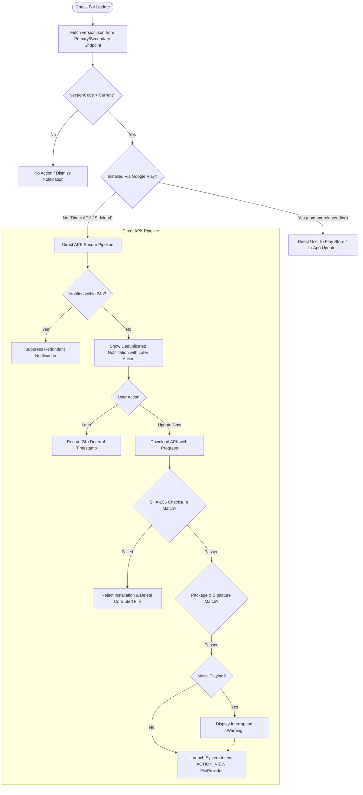

# Smart Application Update System Architecture

## Overview
LofiQ Music provides a robust, dual-channel release discovery, integrity validation, and installation system supporting both **Google Play In-App Updates** and **Authorized Direct APK Distribution**.

---

## 1. Distribution Channel Detection

---

## 2. Release Discovery & Validation

### Dual Endpoint Redundancy
1. **Primary Endpoint**: Vercel (`https://lofiq-web.vercel.app/version.json`)
2. **Operational Secondary**: Netlify (`https://mybackuplofiq.netlify.app/version.json`)
- Strict qualification rules: Fallback occurs only on DNS failure, connection timeout, transport TLS failure, or HTTP 5xx errors. Client errors (4xx) or malformed JSON fail immediately without exposing fallback endpoints.

### Integrity Verification Pipeline
1. **SHA-256 Digest Verification**: Prior to invoking the system package installer, the downloaded APK's SHA-256 hash is computed in streaming chunks and matched against `expectedChecksum`. Mismatched files are discarded immediately.
2. **Package Identity Check**: Uses Android `PackageManager.getPackageArchiveInfo()` to verify that the downloaded package matches `com.sargamify.app` before passing it to `FileProvider`.
3. **Minimum SDK Compatibility**: Validates `minSdkVersion` against device `Build.VERSION.SDK_INT`.

---

## 3. Notification Deduplication & User Control
- **Dedicated Notification Channel**: `lofiq_app_updates` with high priority.
- **24-Hour Cooldown**: Notifications for the exact same version are throttled to a minimum of 24 hours.
- **Action Buttons**:
  - **Update Now**: Launches `MainActivity` with download flags.
  - **Later**: Broadcasts to `UpdateNotificationReceiver`, saving the dismissal timestamp and closing the notification without badgering the user.
- **Android 13+ Support**: Explicitly guards against missing `POST_NOTIFICATIONS` permission.

---

## 4. In-App User Interface (`MainScreen.kt`)
- Displays:
  - Installed version vs New version (`v1.0.6` → `v1.0.7`).
  - Download size.
  - Formatted release notes.
  - Live downloading progress bar with percentage.
  - Active playback notice: *"Active music playback will pause when installing this update."*
- Channel-aware button: Shows **"Update on Play Store"** for Google Play users, or **"Update Now"** with direct download for sideloaded users.
